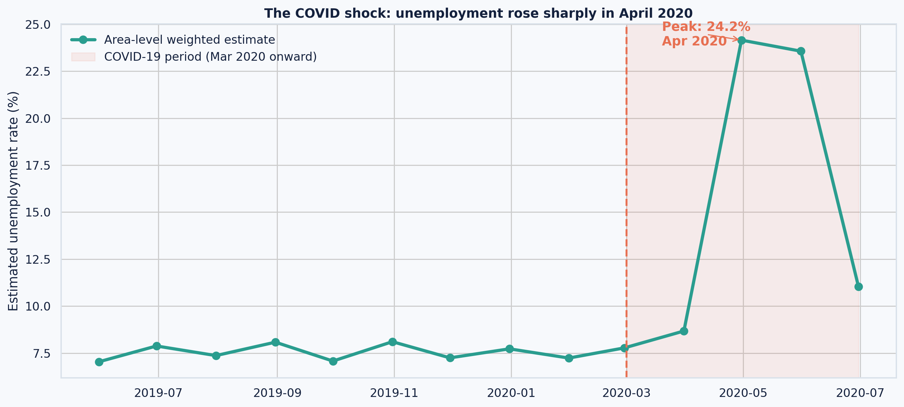
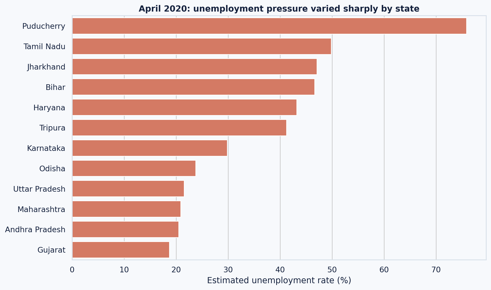
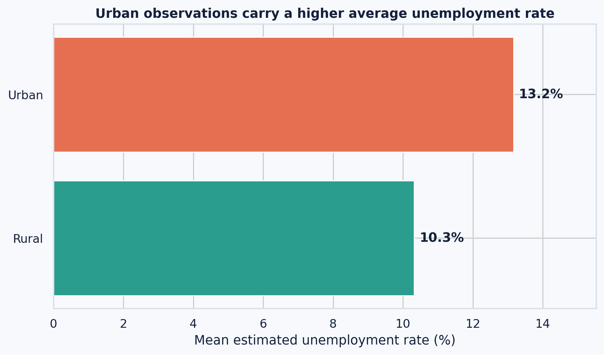
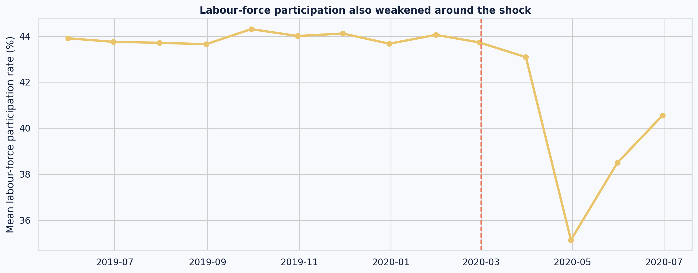
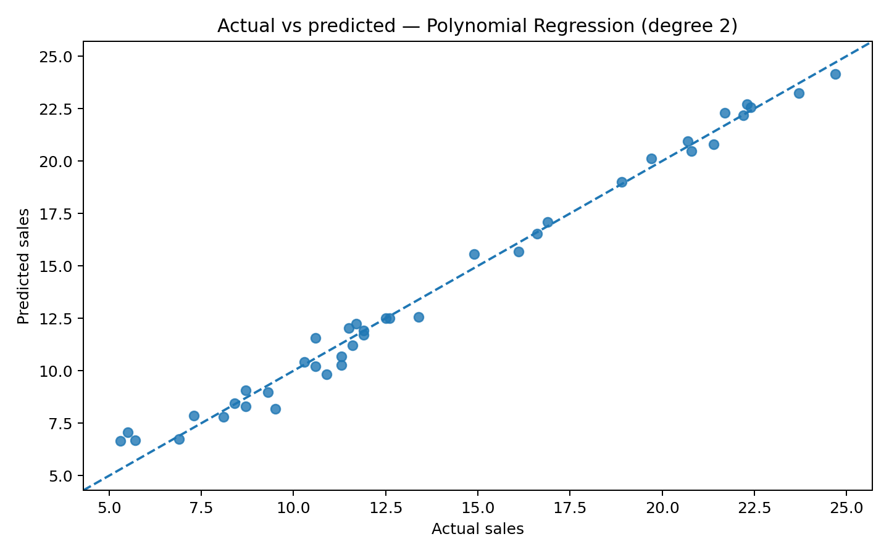
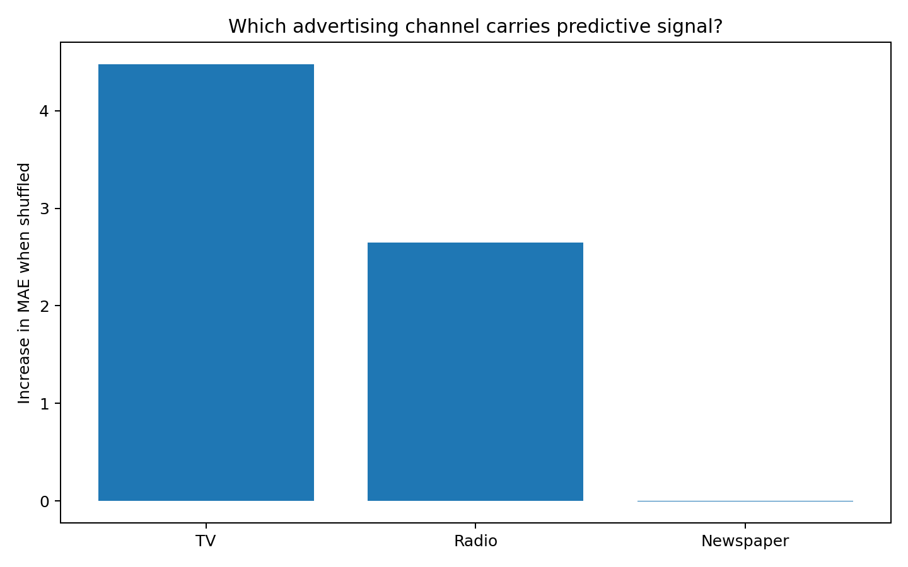
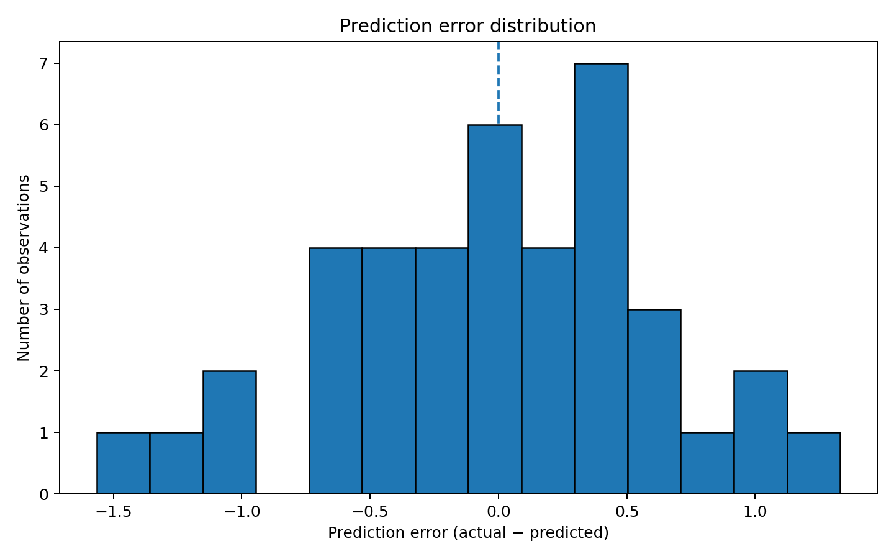

<div align="center">


<a href="https://github.com/aranna05/CodeAlpha_tasks">
  
</a>

<br/>


</div>

---

## 👋 About This Repository

This repository showcases the work I completed during my **Data Science internship at CodeAlpha**. Each project is a complete, reproducible workflow: a polished Jupyter notebook, a standalone Python script, the source data, and ready-made charts and outputs.

| # | Project | Type | Headline result |
|:-:|---------|------|-----------------|
| 1 | [📉 Unemployment Analysis in India](#-project-1--unemployment-analysis-in-india) | Exploratory data analysis | Unemployment jumped from about **7.6%** to **24.2%** in April 2020 |
| 2 | [📈 Sales Prediction (Sales Signal)](#-project-2--sales-prediction-sales-signal) | Regression / ML | **R² = 0.988** on held-out data with a degree-2 polynomial model |

---

## 🗂️ Repository Structure

```text
Internship_CodeAlpha/
│
├── 📉 Unemployment_Analysis_India_CodeAlpha/
│   ├── Unemployment_Analysis_India.ipynb     # guided, presentation-ready notebook
│   ├── unemployment_analysis.py              # script version of the analysis
│   ├── Unemployment in India.csv             # area-level source data
│   ├── Unemployment_Rate_upto_11_2020.csv    # state-level source data
│   └── outputs/                              # 6 charts + cleaned CSVs
│
├── 📈 Sales_Prediction_CodeAlpha/
│   ├── Sales_Signal_Sales_Prediction.ipynb   # EDA, modelling, diagnostics
│   ├── sales_prediction.py                   # standalone training pipeline
│   ├── data/Advertising.csv                  # TV, Radio, Newspaper → Sales
│   └── outputs/                              # model, metrics, charts
│
├── LICENSE
└── README.md
```

---

## 📉 Project 1 · Unemployment Analysis in India

> **How hard did COVID-19 hit India's job market, and who felt it most?**

A reproducible analysis of two datasets covering Indian unemployment before and during the pandemic.

### 🎯 What it does

- 🧹 **Cleans** whitespace, dates, numeric fields, blanks and duplicates (740 area-level and 267 state-level valid rows)
- 🧮 **Rebuilds a weighted monthly rate** from the implied unemployed count, `unemployed = employed × rate / (100 − rate)`, which is more defensible than a plain average of regional rates
- ⏱️ **Compares** the pre-COVID period (to Feb 2020) with March 2020 onward
- 🏙️ **Explores** rural vs urban gaps, state-level hotspots and labour-force participation

### 📊 Demo

<div align="center">



**The shock:** the weighted rate hovered around 7–8%, then spiked to a peak of **24.2% in April 2020**.

</div>

<br/>

<table>
<tr>
<td width="50%" align="center">

<br/><b>🔥 State hotspots</b><br/>
In April 2020 Puducherry reached about 76%, with Tamil Nadu, Jharkhand, Bihar and Haryana all above 40%.
</td>
<td width="50%" align="center">

<br/><b>🏙️ Urban vs rural</b><br/>
Urban observations average <b>13.2%</b> against <b>10.3%</b> for rural ones.
</td>
</tr>
</table>

<div align="center">



**Participation fell too:** the labour-force participation rate dropped from about 44% to roughly 35% at its low point, then began to recover.

</div>

### 🔑 Key takeaways

- 📈 Unemployment roughly tripled in a single month once lockdowns began
- 🗺️ The impact was highly uneven across states
- 👥 People also left the labour force, not just lost jobs

### ▶️ Run it

```bash
cd Unemployment_Analysis_India_CodeAlpha
python -m pip install pandas numpy matplotlib seaborn jupyter
python unemployment_analysis.py            # regenerates charts and cleaned CSVs
# or explore interactively
jupyter notebook Unemployment_Analysis_India.ipynb
```

> ⚠️ **Note:** The reconstructed national series is an estimate, not an official statistic. The March 2020 split is descriptive and does not prove a causal COVID effect.

---

## 📈 Project 2 · Sales Prediction (Sales Signal)

> **Can advertising spend on TV, Radio and Newspaper predict sales?**

An end-to-end regression project on the classic `Advertising.csv` dataset: 200 rows, three ad channels, one sales target, and no missing values.

### 🎯 What it does

- 🔍 Validates the data and explores relationships between spend and sales
- 🏁 **Compares 5 models** under the same 80/20 split and shuffled 5-fold cross-validation
- 🧠 Explains the winner with **permutation importance** on unseen data
- 💾 Saves the trained pipeline (`.joblib`) so it can be reused for predictions

### 🏆 Model leaderboard

| Rank | Model | CV MAE ↓ | Test MAE ↓ | Test RMSE ↓ | Test R² ↑ |
|:----:|-------|:--------:|:----------:|:-----------:|:---------:|
| 🥇 | **Polynomial Regression (deg 2)** | **0.441** | **0.485** | **0.621** | **0.988** |
| 🥈 | Random Forest | 0.665 | 0.661 | 0.791 | 0.980 |
| 🥉 | Gradient Boosting | 0.707 | 0.695 | 0.854 | 0.977 |
| 4 | Linear Regression | 1.237 | 1.461 | 1.782 | 0.899 |
| 5 | Ridge Regression | 1.237 | 1.464 | 1.787 | 0.899 |

### 📊 Demo

<table>
<tr>
<td width="50%" align="center">

<br/><b>🎯 Actual vs predicted</b><br/>
Points hug the diagonal, so predictions track real sales closely.
</td>
<td width="50%" align="center">

<br/><b>📡 Which channel matters?</b><br/>
TV carries the most predictive signal, Radio is second, and Newspaper adds almost nothing.
</td>
</tr>
</table>

<div align="center">



**Errors are centred on zero**, with most predictions within about ±1 sales unit.

</div>

### 🔑 Key takeaways

- 🚀 Adding polynomial terms lifts R² from **0.899** (linear) to **0.988**, which suggests the channels interact
- 📺 TV and 📻 Radio drive the predictions; 📰 Newspaper is practically noise
- ⚠️ Predictive importance is **not** causal ROI. Test with controlled experiments before moving real budgets

### ▶️ Run it

```bash
cd Sales_Prediction_CodeAlpha
pip install pandas numpy matplotlib scikit-learn joblib jupyter
python sales_prediction.py                 # trains, evaluates, saves outputs/
# or explore interactively
jupyter notebook Sales_Signal_Sales_Prediction.ipynb
```

---

## 🛠️ Tech Stack

| Area | Tools |
|------|-------|
| **Language** | Python |
| **Data wrangling** | Pandas, NumPy |
| **Visualisation** | Matplotlib, Seaborn |
| **Machine learning** | scikit-learn (pipelines, cross-validation, permutation importance), joblib |
| **Workflow** | Jupyter Notebook, Git & GitHub |

---

## 🚀 Quick Start

```bash
# 1. Clone the repository
git clone https://github.com/aranna05/Internship_CodeAlpha.git
cd Internship_CodeAlpha

# 2. Install everything once
pip install pandas numpy matplotlib seaborn scikit-learn joblib jupyter

# 3. Run either project
python Unemployment_Analysis_India_CodeAlpha/unemployment_analysis.py
python Sales_Prediction_CodeAlpha/sales_prediction.py
```

---

## 🙌 What I Learned

- Cleaning messy real-world data and checking its quality before analysing it
- Choosing honest aggregation methods and stating a model's limits clearly
- Comparing several models fairly with a fixed split and cross-validation
- Turning numbers into charts and takeaways that others can act on

---

## 📜 License

Released under the terms of the [LICENSE](LICENSE) file in this repository.
Thank You

<div align="center">

### ⭐ If you found this useful, consider giving the repo a star!


</div>
